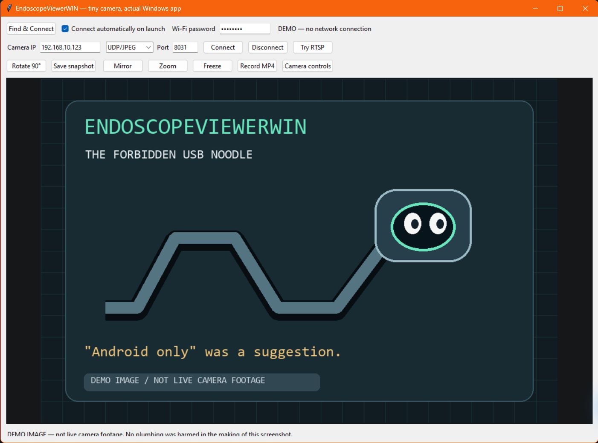

# EndoscopeViewerWIN

### Your tiny Wi-Fi camera. Your actual Windows PC. Zero mandatory phone yoga.

> **Camera packaging:** “Android / iOS.”
>
> **Us:** “Screw that. It's sending packets. We have a computer.”

So we inspected how **HD WIFI** talks to a LIMINK endoscope, figured out its video protocol, and built a Windows desktop viewer.

No Android emulator. No phone balancing on a toolbox. No sacrificing an afternoon to an app that thinks a settings screen is a personality.



*Actual Windows app displaying a synthetic demo image. No live camera footage appears in this screenshot.*

## What works

- **Find & Connect:** discover recognized camera hotspots, join using the supplied password, verify a camera response, and start the viewer.
- Automatic camera connection on launch, with a switch to turn it off.
- Live **MoLink-family UDP/JPEG video**, verified at **640 × 480** on our LIMINK unit.
- Rotate, mirror, freeze, and digital zoom.
- PNG snapshots of the displayed view.
- MP4 recording through FFmpeg. Recording uses the original camera orientation and a 15 fps output timeline.
- **40 camera-control entries**, including information queries, resolution, format, lighting, focus, lens switching, motor-related controls, and camera Wi-Fi settings.
- Clear command results: a reply, a timeout, or an error. A silent camera doesn't earn a “success” sticker.


*Some controls are for other hardware using the same library. A focus button cannot grow a motor inside a fixed-focus camera. We asked nicely.*

## Which cameras work?

**One physical camera is verified so far.** A familiar brand name or SSID is a clue, not a compatibility certificate.

| Camera / family | Status | What we know |
| --- | --- | --- |
| **LIMINK Wi-Fi endoscope — our test unit** | **Verified** | `Jetion_…` hotspot, firmware query returns `100`, JPEG video over UDP `8031`, 640 × 480. Exact retail model has not been recorded. |
| Other **Jetion / MoLink** cameras using **HD WIFI** | **Candidates; untested** | Best protocol match. Firmware and framing can still differ. |
| **NIDAGE** models supplied with HD WIFI, such as the AW655 family | **Candidates; untested** | Their documented app makes them worth testing; this is not a brand-wide support claim. |
| **DEPSTECH** models with a `Jetion_…` hotspot | **Candidates; untested** | Some models belong to the Jetion ecosystem. Newer DEPSTECH protocols are not automatically supported. |
| **Eloam** devices using the related MoLink protocol | **Candidates; untested** | The Android code contains an Eloam-to-Jetion name-handling branch. |
| Ordinary USB UVC webcams | **Not implemented** | This app currently receives Wi-Fi video. |
| Arbitrary UDP cameras, ONVIF cameras, or every device with “HD” on the box | **Not universal support** | Different framing and control protocols require their own receivers. |

Useful references: [HD WIFI on Google Play](https://play.google.com/store/apps/details?id=com.molink.john.hdwifi), [DEPSTECH's Jetion connection instructions](https://depstech.com/de-de/products/wifi-endoscope-wf028-5m), and [NIDAGE AW655 manual listing](https://www.manuallib.com/file/nidage-aw655-user-manual/).

Have another working model? Open an issue with its **brand, exact model, companion app, firmware response, video resolution, and transport**. Please leave passwords and private camera pictures out of the report.

## Get running on Windows

This is currently a **Python desktop application**, not a packaged `.exe` installer.

### Requirements

- Windows 10 or 11; development testing was performed on Windows.
- Python **3.10 or newer**, with Tkinter.
- Pillow, installed by the setup script.
- A Wi-Fi adapter that can join the endoscope's 2.4 GHz hotspot.
- **FFmpeg on PATH** for MP4 recording; `ffplay` is used only for the optional RTSP diagnostic. Live JPEG viewing and snapshots do not require FFmpeg.

### Quick start

1. Clone or download this repository.
2. Run **`Setup.cmd`** once to create a local virtual environment and install Pillow.
3. Power on the endoscope and plug in your PC's Wi-Fi adapter.
4. Run **`Start Viewer.cmd`**.
5. Use **Find & Connect**. The default camera Wi-Fi password is `12345678`; change it in the viewer if your unit uses another password.

Prefer a terminal?

```powershell
py -3 -m venv .venv
.\.venv\Scripts\python.exe -m pip install -r requirements.txt
.\.venv\Scripts\python.exe viewer.py
```

If you keep development files on a particular drive, clone the repository there: the virtual environment and setup-script pip cache stay inside the project.

### Manual connection

Join the camera hotspot in Windows, then choose:

```text
Camera IP:  192.168.10.123
Mode:       UDP/JPEG
Port:       8031
```

Click **Connect**. Ethernet can stay connected for internet access while Wi-Fi handles the camera.

## Automatic Wi-Fi: how smart is it?

It searches for camera-like SSIDs beginning with **Jetion, Eloam, LIMINK, NIDAGE, MoLink, HDWiFi, HD_WiFi, or HD WiFi**. These are candidate names, not an assertion that every camera behind them works.

The currently connected camera is preferred, then the last-used camera, then stronger signals. When joining is needed, the app creates a Windows profile for that camera using the supplied password and verifies its MoLink version response. It allows time for DHCP after association.

The password field is masked. Temporary profile XML is removed after import; Windows manages the saved Wi-Fi profile. Local app preferences store the last SSID and automatic-connection preference, not a password.

Windows can block Wi-Fi enumeration when location access is unavailable. If discovery cannot list adapters or networks, join the hotspot through Windows and use manual Connect. Automatic profile creation currently handles **open** and **WPA2-Personal** hotspots.

## Controls: the whole junk drawer

The Camera controls window exposes the main HD WIFI settings and additional commands found in its shared native camera library:

- **Information:** firmware version, advertised resolutions, format, battery, lens temperature, lighting, camera mode/style, gyroscope type, board info, UVC and motor info.
- **Image and optics:** resolution/FPS requests, format, lens switching, focus position, and autofocus requests.
- **Lighting and hardware:** PWM, white/red/blue channels, lamp switching, movement level, ultrasonic and motor-related requests.
- **Networking:** camera hotspot name, password, channel, stream password, reboot, and power-off.

**Availability in the UI means we implemented the observed request, not that your camera implements it.** Device-specific numeric ranges are not universally documented. Selecting a control sends nothing; you must press Apply or Send.

Changing hotspot settings can disconnect Wi-Fi. Selecting YUYV can stop the picture because the current viewer decodes MJPEG. Re-select MJPEG to restore the supported format. Firmware flashing, factory board-data writes, and calibration are outside the viewer's controls.

## Nerd corner: the camera speaks noodle

The verified video path is a proprietary **UDP/JPEG protocol**, not “any UDP stream.” The receiver sends a small keepalive, reassembles numbered fragments, reverses the camera's one-byte frame transform, and decodes JPEG frames.

The shared library also contains a TCP `7060` path and an RTSP URL. This camera refused those TCP tests. The RTSP button is a diagnostic, not a promise of RTSP support.

More detail: [protocol notes](docs/protocol.md).

No APK, decompiled Android source, or vendor native library is redistributed here. This repository contains our own viewer and protocol implementation. It is an independent project, not an official LIMINK, MoLink, NIDAGE, Eloam, or DEPSTECH product.

## Tested, not manifested into existence

The initial hardware checks covered:

- Real Wi-Fi disconnect and automatic rejoin.
- Automatic camera identification and live 640 × 480 video.
- 47 captured complete frames, with reordered, duplicate, missing, and malformed-packet checks.
- Information queries, UI construction, mirror, zoom, and rotation.
- A four-second MP4: **59 frames, 3.93 seconds, 640 × 480**.

Model-specific setting changes were not blasted at the camera just to see what exploded. The additional controls remain available for deliberate testing.

Run the portable tests with:

```powershell
py -3 -m unittest discover -s tests -v
```

## License

The viewer source is [MIT licensed](LICENSE). Pillow and separately installed FFmpeg retain their own licenses. No FFmpeg binary is bundled.

## Bonus: the forbidden USB noodle


Run `python viewer.py --demo` to meet the mascot without connecting a camera. This is a labeled demo image, not camera footage. “Android only” was a suggestion.

---

Made by someone who looked at a phone-only inspection camera and took that personally.

🔧 More workshop mischief: **[JMSCNC.com](https://jmscnc.com)**

🌀 Actual machining software, fewer tiny camera noodles: **[RotatoCAM.com](https://rotatocam.com)**

